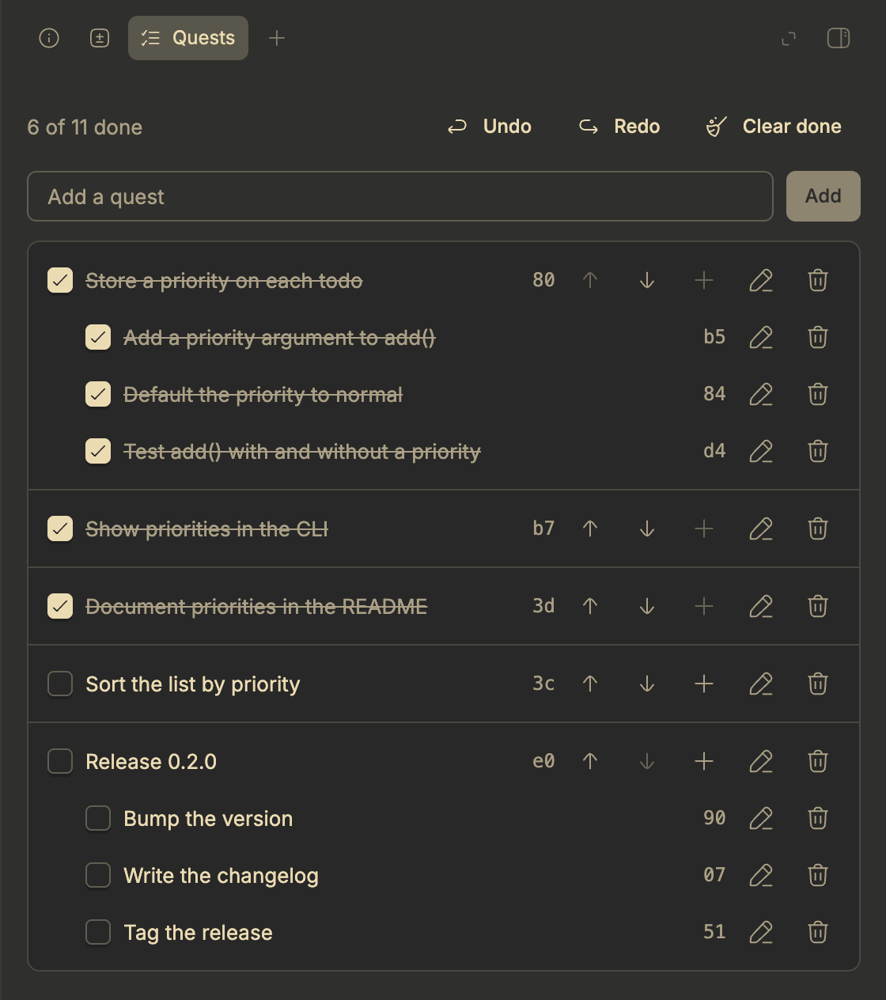
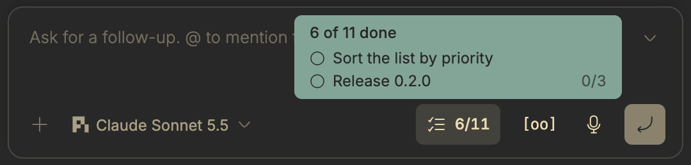

# pi-quests

[](CHANGELOG.md)
[](LICENSE.md)
[](https://github.com/badlogic/pi-mono/tree/main/packages/coding-agent)
[](https://getbb.app)

A quest log for coding agents in [pi](https://github.com/badlogic/pi-mono/tree/main/packages/coding-agent) and [bb](https://getbb.app). Keep your agent on track, one quest at a time.

## Why pi-quests?

Long agent sessions drift. Goals get lost in tool calls, side quests multiply, and the original task is forgotten under a pile of yak hair.

pi-quests gives your agent a quest log: a living TODO list for the current session or thread. The agent breaks the work into quests and steps, ticks them off as it goes, and you can see and edit the list at any time.

- **Stay focused**: the quest log keeps the original goal visible no matter how deep the rabbit hole goes.
- **See progress at a glance**: a progress count in pi's footer or in bb's prompt box shows how far the agent is.
- **Steer the plan**: add, edit, reorder or tick off quests yourself; the agent sees your changes.
- **Undo mistakes**: every change can be undone and redone.

The same quest engine runs in two places. The [bb plugin](#in-bb) gives every bb thread a quest log, whichever agent runs it. The [pi extension](#in-pi) gives plain pi the same log in the terminal.

## In bb

[bb](https://getbb.app) runs coding-agent threads on several agent providers, and this repository is also a bb plugin. Install it from Git, or from a local checkout after running `npm ci --ignore-scripts` in it:

```bash
bb plugin install git:https://github.com/kalindudc/quests
bb plugin install path:/path/to/quests
```

Do not install it from npm: the npm package contains only the pi extension, so `bb plugin install npm:pi-quests` would find no bb entry files. If you also use pi, run `pi update` first: pi-quests 0.9.0 and earlier register the same `quest` tool as the plugin, and pi refuses to start a bb thread that loads both.

Every bb thread then gets:

- one `quest` tool, whichever provider runs the thread: pi, Claude Code, Codex, or an ACP agent such as Cursor or opencode;
- a **Quests** tab in the thread's side panel, where you can add, edit, reorder, tick off and delete quests and steps, and undo or redo changes;
- a progress chip in the prompt box that lists the open quests on hover and opens the Quests tab when clicked.





Each thread keeps its own quests across bb restarts, and a forked thread starts with a copy of its source's quests. See [Quests in bb](docs/bb.md) for the details.

## In pi

```bash
pi install npm:pi-quests
```

The agent gets the `quest` tool, and you get the `/quests` command, a footer progress count, and an interactive quest list (`ctrl+shift+l`).

```
/quests help

Available /quests subcommands:
  add <description>           - Add a new top-level quest
  add-step <id> <description> - Split a quest into a step
  list               - List all quests
  toggle <id> [moreIds...] - Toggle one or more quests
  delete <id> [moreIds...] - Delete one or more quests
  update <id> <desc> - Update a quest description
  reparent <id> [parentId] - Reparent a quest/step (omit parentId to promote)
  reorder <id> <targetId> - Reorder a quest before the target quest
  undo               - Undo the last quest change
  redo               - Redo the last undone action
  clear [all]        - Clear completed quests, or optionally all quests
  version            - Show version
  changelog          - Show changelog
  h, help            - Show this help message
```


In a bb pi thread the extension steps aside and the bb plugin serves the thread, so the agent sees one quest tool. Plain pi and pi under Herdr keep the extension.

### Configuration

The pi extension reads configuration from pi's settings files. Global settings live at `~/.pi/agent/settings.json` and project overrides go in `.pi/settings.json`. The bb plugin has no settings.

```json
{
  "pi-quests": {
    "ids": { "length": 2 },
    "display": {
      "pageSize": 10,
      "progressBarMaxWidth": 24
    }
  }
}
```

See [docs/configuration.md](docs/configuration.md) for the full options reference.

## Develop

```bash
npm ci
```

- Install the checkout into bb once with `bb plugin install path:$PWD`, then run `bb plugin dev $PWD` while you work. It rebuilds and reloads the plugin on every save anywhere in the repository except `dist/`, `node_modules/` and `.git/`, so saves in `tmp/` count too. Without it, `bb plugin reload pi-quests` rebuilds from the current files.
- bb applies tool and instruction changes when a thread starts a new provider session, so test those in a new thread.
- pi sessions started in this checkout load `extensions/pi` from the working tree, because `.pi/settings.json` points there.

## Documentation

| Doc | Description |
|-----|-------------|
| [Quests in bb](docs/bb.md) | The bb plugin: the quest tool for every provider, the Quests tab and the progress chip |
| [Pattern](docs/pattern.md) | "How do I...?" recipes for common workflows |
| [Quests](docs/quests.md) | What are quests? |
| [Reference](docs/reference.md) | Complete tool and command schemas, types |
| [Configuration](docs/configuration.md) | pi settings, overrides, and examples |
| [Architecture](docs/architecture.md) | Module map, data flow diagrams, design decisions |
| [Changelog](CHANGELOG.md) | Version history |

## License

MIT — see [LICENSE.md](LICENSE.md)
