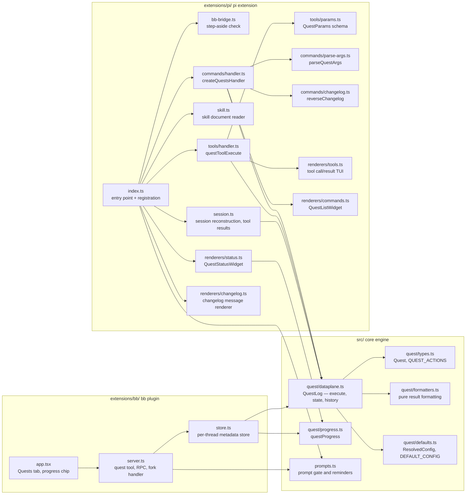
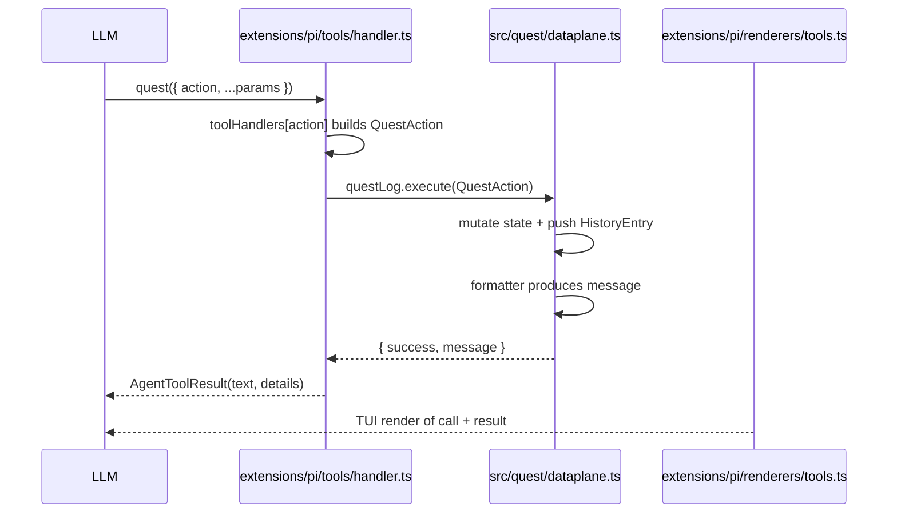
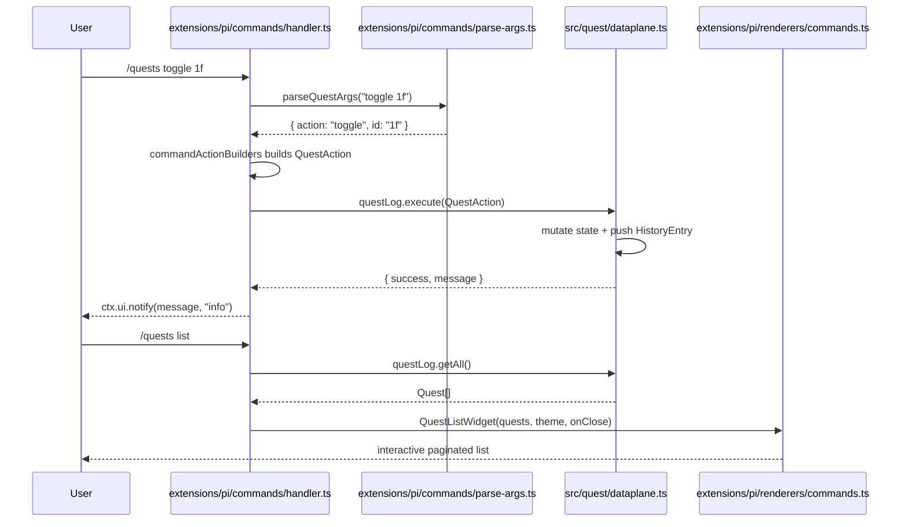
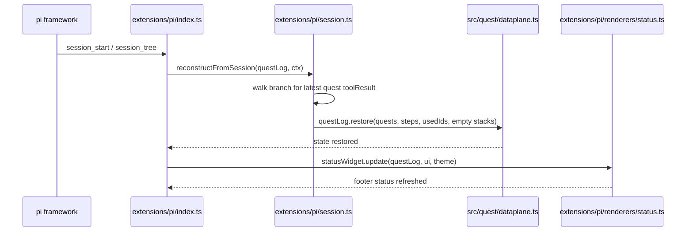

# Architecture

> See also: [Pattern](pattern.md) · [Reference](reference.md) · [Quests](quests.md)

## Overview

pi-quests is a quest log for coding agents. Its engine in `src/` runs in two hosts:

- The [pi](https://github.com/earendil-works/pi-mono/tree/main/packages/coding-agent) extension in `extensions/pi/` adds a session-scoped quest log with one LLM-callable tool (`quest`) and one command namespace (`/quests`), both operating on a shared in-memory `QuestLog` dataplane. It loads via `pi install npm:pi-quests` (or `pi -e ./extensions/pi/index.ts` for local development) and registers the tool, command, message renderer, session event hooks, and system prompt injection.
- The bb plugin in `extensions/bb/`, described in [bb thread state](#bb-thread-state).

## Repository layout

The repository is one package. Its root `package.json` holds both manifests: `pi` loads `extensions/pi/index.ts`, and `bb` loads `extensions/bb/server.ts`, `extensions/bb/app.tsx` and the skills in `src/skills/`. The engine knows nothing about either host, and the hosts never import each other, types included:

| Path | Role | May import |
|------|------|------------|
| `src/` | Core engine | Files in `src/`, Node built-ins and the root's runtime `dependencies` |
| `extensions/pi/` | pi extension | Its own files, core by relative path, pi packages |
| `extensions/bb/` | bb plugin | Its own files, core by relative path, bb packages |

`test/layout.test.ts` enforces these rules, and the tests mirror the source roots in `test/core/`, `test/pi/` and `test/bb/`. Both hosts reach core by relative path. The npm package ships `src/` beside `extensions/pi/` and nothing of bb. bb installs the whole repository as the plugin, so `../../src/...` from `extensions/bb/` stays inside the plugin directory, which bb requires when it builds the server from source. The one skill document lives in `src/skills/` because it describes the core quest tool: pi's `skill` action reads it, and bb loads it through `bb.skills`.

## Module map



| Module | Purpose |
|--------|---------|
| `src/quest/types.ts` | `Quest`, `QUEST_ACTIONS`, `QUEST_ACTION_VALUES` — domain constants and types |
| `src/quest/formatters.ts` | Pure formatting functions for all quest results |
| `src/quest/dataplane.ts` | `QuestLog` — quest array, random hex IDs, history stack, `execute()`, revert, JSON state (`toJSON`, `restore`, `fromJSON`) |
| `src/quest/defaults.ts` | Pure `ResolvedConfig` and `DEFAULT_CONFIG`, shared by pi and bb |
| `src/quest/progress.ts` | `questProgress` — done and total over quests and steps, shared by pi's footer and bb |
| `src/prompts.ts` | `QUEST_PROMPT_GATE` and `QUEST_PROMPT_REMINDER`, shared by pi and bb |
| `src/skills/quest-management/SKILL.md` | The quest skill document |
| `extensions/pi/index.ts` | pi entry point — creates `QuestLog`, registers tools/commands/renderers, wires session hooks |
| `extensions/pi/session.ts` | pi session reconstruction and the `quest` tool result shape |
| `extensions/pi/skill.ts` | Reads the core skill document for the `skill` and `rules` actions |
| `extensions/pi/bb-bridge.ts` | `shouldStepAside` — reads bb's `PI_BB_TOOLS_FILE` |
| `extensions/pi/config.ts` | pi settings loader (`getConfig`) |
| `extensions/pi/tracker.ts` | `QuestUsageTracker` — counts quest and other tool calls |
| `extensions/pi/tools/params.ts` | `QuestParams` — Typebox schema for the `quest` tool |
| `extensions/pi/tools/handler.ts` | `quest` tool implementation (`questToolExecute`, `registerQuestTool`) |
| `extensions/pi/commands/parse-args.ts` | `/quests` argument tokenizer and parser |
| `extensions/pi/commands/changelog.ts` | `reverseChangelog` helper for changelog display |
| `extensions/pi/commands/handler.ts` | `/quests` command dispatcher |
| `extensions/pi/renderers/tools.ts` | TUI renderers for tool calls and results |
| `extensions/pi/renderers/commands.ts` | `QuestListWidget` — interactive paginated quest list |
| `extensions/pi/renderers/status.ts` | `QuestStatusWidget` — footer status line progress indicator |
| `extensions/pi/renderers/changelog.ts` | Message renderer for `quest-changelog` messages |
| `extensions/pi/logger.ts` | Namespaced debug logging |
| `extensions/pi/version.ts` | Version and changelog path constants |
| `extensions/bb/server.ts` | bb backend — the `quest` tool, the `getLog` and `mutate` RPC methods, the fork handler |
| `extensions/bb/store.ts` | Per-thread quest state in bb thread metadata |
| `extensions/bb/app.tsx` | Quests tab and progress chip |

## Data flow

All mutations flow through the dataplane's `execute()` method. Adapters (tool and command handlers) only do three things:
1. Parse framework-specific input into a `QuestAction`
2. Call `questLog.execute(action)`
3. Adapt the result back to the framework (tool result, UI notification, or widget)

### Tool execution



The tool result always includes `details: { quests, usedIds }`. This lets the framework (and our session reconstruction logic) recover the full quest state from the session branch later.

### Command execution



Meta commands (`version`, `changelog`, `help`) and the `list` command short-circuit the dataplane because they do not mutate quest state.

### Session reconstruction



`restore` checks the whole state before it changes anything: field types, unique ids, every live id in `usedIds`, and a parent quest for every step. It throws `InvalidQuestLogStateError` and leaves the log as it was. Sessions saved by pi-quests 0.1 to 0.3 stored numeric quest ids, which fail that check. For such a session, `extensions/pi/index.ts` empties the log, warns once per session that the saved quests came from an older pi-quests, and still registers the `quest` tool and `/quests`.

### Status widget

`QuestStatusWidget` (in `extensions/pi/renderers/status.ts`) writes a compact progress indicator to the footer via `ctx.ui.setStatus("pi-quests", text)`. It updates on:
- `session_start` and `session_tree` (after reconstruction)
- `tool_execution_end` when the `quest` tool was executed
- every mutating `/quests` command (via an `onMutate` callback)

When no quests exist, the status is cleared (`undefined`) to avoid visual noise.

### Widget invalidation

`QuestListWidget` caches its rendered lines for performance. Because the widget instance is created inside `ctx.ui.custom()`, there was previously no way to invalidate the cache when quest state mutated from commands or tools. The fix keeps a module-level `activeQuestListWidget` reference and exports `invalidateQuestListWidget()`, which both the command handler and tool handler call after every mutating action.

Because every tool result stores `details: { quests, usedIds }`, the entire `QuestLog` can be rebuilt by scanning the current session branch. No disk persistence is required, and quest state survives branch switches automatically.

## Key concepts

### The dataplane as the single source of truth

`QuestLog` lives in `src/quest/dataplane.ts` and is the **only** module that mutates quest state. All other layers adapt external input into a `QuestAction` and call `execute()`:

```typescript
export type QuestAction =
  | { type: "add"; descriptions?: string[] }
  | { type: "split"; id?: string; descriptions?: string[] }
  | { type: "add_step"; id?: string; descriptions?: string[] }
  | { type: "list" }
  | { type: "toggle"; id?: string; ids?: string[] }
  | { type: "update"; id?: string; description?: string }
  | { type: "delete"; id?: string; ids?: string[] }
  | { type: "clear"; all?: boolean }
  | { type: "reorder"; id?: string; targetId?: string }
  | { type: "undo" }
  | { type: "redo" }
  | { type: "reparent"; id?: string; parentId?: string }
  | { type: "rules" }
  | { type: "skill" };
```

This means:
- Tool handlers never call `questLog.add()` directly
- Command handlers never call `questLog.toggle()` directly
- Renderers and widgets are read-only

### History and undo/redo

Every mutating action pushes a typed `HistoryEntry` onto a stack. Calling `undo` pops the most recent entry and restores the previous state:

| Action | History entry | Undo behavior |
|--------|---------------|---------------|
| `add` | `{ type: "add", id }` | Removes the added quest; restores used ID |
| `split` | `{ type: "split", id, descriptions }` | Removes the added steps one by one (no custom history entry) |
| `toggle` | `{ type: "toggle", id }` | Flips the `done` flag back |
| `update` | `{ type: "update", id, previousDescription }` | Restores the previous description |
| `delete` | `{ type: "delete", quest, index, isStep?, cascadeDeletedSteps? }` | Reinserts the quest at its original index; restores cascade-deleted steps |
| `clear` | `{ type: "clear", previousQuests, previousSteps?, all }` or `{ quests, steps?, all }` | Restores the full quest array and used IDs |
| `reorder` | `{ type: "reorder", quest, oldIndex, previousIds, targetId }` | Restores the original order and IDs |

The undo logic is implemented as a typed `undoHandlers` map — one handler per `HistoryEntry` type — rather than an if-chain. Calling `redo` replays the most recently undone action by pushing a `RedoEntry` and applying `redoHandlers`. The redo stack is cleared on any new mutation. Redo reuses the same public mutation methods where possible, so history is automatically repopulated.

### Prompt injection

On `before_agent_start`, the extension prepends a high-salience `# Quest Management` gate to the system prompt (exploiting primacy bias). While the quest log is empty, it also appends a reminder block (exploiting recency) that asks the agent to learn the quest tool and start tracking the task. This creates an instruction sandwich that encourages the agent to track work as specific, actionable quests before any file reads or edits.

To preserve prompt-cache hits, the injected text is static: it never embeds counts, IDs, or per-session interpolation, so cache keys remain stable across turns. The extension does not register a `context` handler for dynamic reminder messages; runtime guidance comes from explicit quest tool use, commands, static prompt text, and tool metadata.

The `quest` tool registration also supplies `promptSnippet` and `promptGuidelines`, which the framework injects into the default system prompt when the tool is active.

## bb thread state

The plugin in `extensions/bb/` runs the same engine inside bb, the getbb.app workspace for agent threads, so a thread on any agent provider gets the `quest` tool. `extensions/bb/server.ts` registers that tool and two RPC methods, `getLog` and `mutate`, for the frontend in `extensions/bb/app.tsx`, which adds a Quests tab to the thread's side panel and a progress chip to the action row of the thread's prompt box, beside voice and send. The chip shows done and total counts, lists up to five open quests on hover, and opens the Quests tab when clicked. Both paths go through `extensions/bb/store.ts`, so the tool and the tab edit one log. The server reads no files: bb loads `src/skills/quest-management/SKILL.md` as a plugin skill, and the `skill` and `rules` actions point to it.

The store keeps each thread's state in bb's thread metadata under the fixed namespace `quests` rather than the plugin id, so other plugins can read the progress and a package rename keeps every thread's quests:

| Key | Contents |
|-----|----------|
| `log` | `QuestLog.toJSON()`: quests, steps, used IDs, and the newest 50 undo and 50 redo entries |
| `progress` | `{ done, total, current }` over every quest and step, the count pi's footer shows; `current` is the first unfinished top-level quest |
| `pendingUserChanges` | Edits made in the Quests tab that the agent has not seen yet: the newest 50, then one `and N earlier changes` line |

Each operation reads the namespace, runs one action, and writes all three keys in a single metadata update under a per-thread lock, then publishes `{ threadId }` on the `quests` realtime channel so open tabs and chips refetch. A failed action writes nothing. An edit in the tab is appended to `pendingUserChanges`; the next quest tool result starts with those edits and clears them. Invalid saved state is reported as an error rather than replaced. bb refuses a namespace over 256 KiB, so a write that would exceed it first drops the oldest undo or redo entry, from the longer stack, until it fits, then folds the oldest pending edits into the count line; only quests that alone exceed the limit fail the write.

The Quests tab and the chip refetch on that signal and again whenever the realtime connection comes back, since signals sent while it was down are not replayed. Answers can arrive out of order, so a `getLog` answer is applied only if no newer request or change has answered since it was asked. The tab sends one change at a time and disables its change controls until the answer arrives.

Forks do not inherit metadata, so the store copies the source's log, without its pending edits, into a fork the first time bb announces it (`thread.created`) or the first time anything reads it. Side chats start with an empty log.

### Stepping aside in bb

Before pi starts, bb's pi provider writes the tools it bridges into pi to a file named by `PI_BB_TOOLS_FILE`. When that file lists a `quest` tool, `extensions/pi/index.ts` returns before registering anything, so a bb pi thread sees only the plugin's tool. An unset, unreadable, or malformed file keeps plain pi behavior.

Known limitation: a pi started from a shell inside a bb pi thread inherits `PI_BB_TOOLS_FILE`, steps aside, and has no quest tool, because bb's bridge is not loaded in that pi.

## Design decisions

### Centralized formatting

All user-facing message strings live in `src/quest/formatters.ts`. They are pure functions with no framework dependencies. This makes them easy to test in isolation and ensures commands and tools present identical wording for the same operation.

### Adapter thinness

`extensions/pi/tools/handler.ts` and `extensions/pi/commands/handler.ts` are deliberately thin. They do not contain business logic; they only bridge the pi framework to the dataplane. This keeps the codebase maintainable as new features are added — future tools or commands will follow the same three-step adapter pattern.

### Session reconstruction without persistence

Because pi stores tool results in the session branch, we can rebuild `QuestLog` entirely from conversation history. This avoids file I/O for state storage and guarantees that branch switches always see the correct quest snapshot for that branch. bb has no such branch, so the bb plugin persists the log in thread metadata instead.
