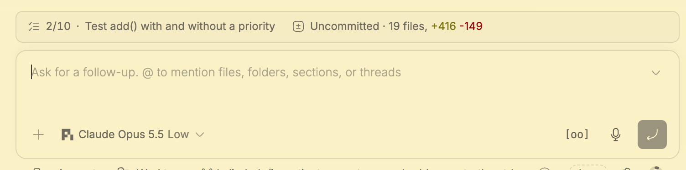
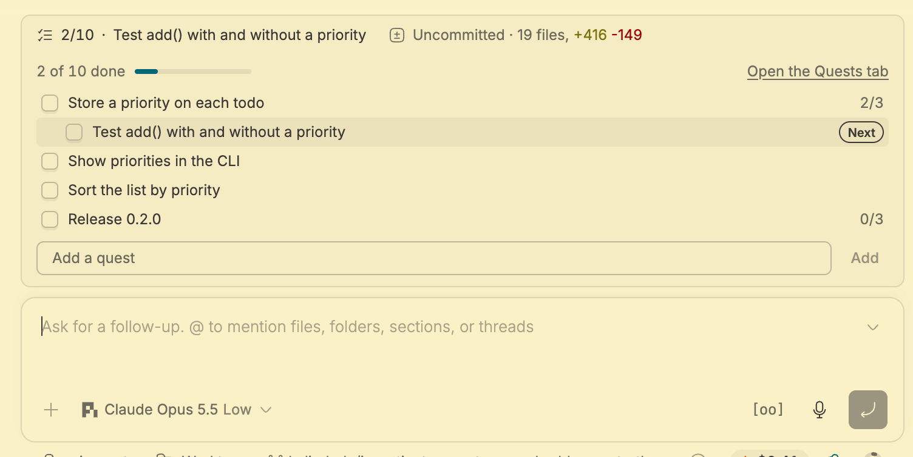
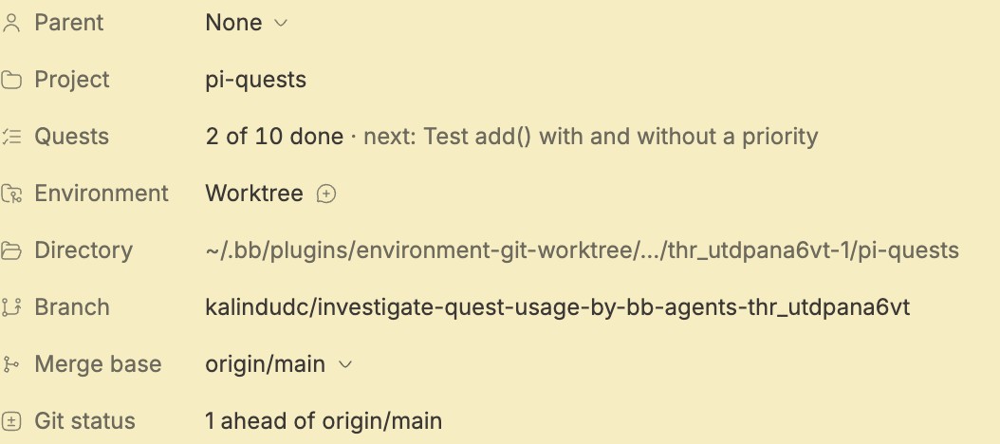

# Quests in bb

> See also: [Reference](reference.md) · [Quests](quests.md) · [Architecture](architecture.md#bb-thread-state)

The bb plugin gives every [bb](https://getbb.app) thread its own quest log. The agent tracks its work with the `quest` tool, and you follow and edit the same log above the composer, in the thread's Quests tab and in its Info tab. The [README](../README.md#in-bb) shows how to install it.

## Every provider gets the same tool

The plugin registers one `quest` tool with bb, and bb hands it to whichever provider runs the thread. The plugin does not depend on pi or on any other provider:

| Provider | How the agent sees the tool |
|----------|-----------------------------|
| pi | A native `quest` tool. The pi-quests extension [steps aside](#pi-threads-in-bb). |
| Claude Code | `mcp__bb-bridge__quest`, through bb's MCP bridge |
| Codex | `quest` on bb's MCP server |
| ACP agents, such as Cursor, opencode or omp | `quest` on the MCP server bb starts for each ACP session |

The tool takes the same actions and parameters as the pi tool; see the [Reference](reference.md#tool-quest). It returns plain text, so every provider shows the same result, and every change ends with the plan's progress and next item. bb also adds the tool's short usage rules to the thread's instructions, and ships the `quest-management` skill to every provider; the `skill` and `rules` actions point the agent to that skill.

bb applies tool and instruction changes when a thread starts a new provider session, so a thread that was already running when you installed or updated the plugin picks them up in its next session.

## The note at a new request

Agents tend to plan with quests at the start and tick them all off at the end. To bring the log back into view while the work happens, the plugin can add one short, agent-only note to a turn you start. The note gives the progress, the next item and the open quests, and says why it was sent. It goes out only when one of these holds:

- the agent left its open quests unchanged through your previous request, and has had no note since it last changed them;
- you edited the log in bb and the agent has not seen those edits yet.

The plugin sends the note while one of the agent's tools is running. A steered message joins the agent's next model call, so sending it mid-tool adds no call of its own. If the agent calls the quest tool first, or the turn ends before a tool is seen running, no note goes out, and the next request gets another chance. Tools that finish within about a second are usually missed, because bb reports thread activity at most once a second. The note never starts a turn: bb's dispatch checkpoint refuses one that would. Only providers that add a steered message to the running turn get notes: pi, Claude Code and Codex. An ACP agent's steer cancels its prompt, so ACP threads get none.

A thread whose quests were written before this version gets stale-log notes only after its agent next changes the log, since until then the plugin cannot tell when the agent last touched it.

## Above the composer

Quests join bb's context row above the composer, next to bb's parent thread and changed files and other plugins' segments, such as Shuttle's pull requests. The segment sorts right after the parent thread. It shows while a quest is open or the agent has edits of yours to hear about, and starts collapsed; bb keeps one segment of the row open at a time.

- Collapsed, it shows the done and total counts and, while the row has room, the next item. A clock appears once a working agent has left its open quests unchanged for 10 minutes, and a dot while the agent has not seen your edits.
- Expanded, it lists the open quests, the current quest's open steps with the next one marked, and the done count. You can tick items, add a quest and open the Quests tab from there.

To add work without interrupting the agent, open the menu next to the send button and choose **Add as a quest**. You can trim the draft before it goes on the log.

## The Quests tab

Open the Quests tab from the thread's side panel, from the segment above the composer, from the Info tab, or with the **Open the Quests tab** command (⌘⇧L by default). The tab shows the thread's quests with their steps indented beneath them, marks the next item and folds done quests under **Done**. It lets you:

- add a quest, or add a step to a quest;
- tick a quest or step done, or untick it;
- edit a description, or delete a quest after confirming (a quest's steps go with it);
- move an open quest up or down;
- undo and redo changes, whether you or the agent made them;
- clear the quests that are done.

A row's controls appear when you hover over it or focus it, and always on touch screens. Under the progress bar, the tab says when the agent last changed the log, and warns when a working agent has left its open quests unchanged for 10 minutes.

Your changes are not hidden from the agent. The tab lists the ones it has not seen. While a pi, Claude Code or Codex agent is working, **Tell it now** sends them into the running turn as one note; otherwise they reach the agent with your next message, or at the start of its next quest tool result under `The user changed the quest log:`.

The segment, the tab and the Info row share one cached read of the log through bb's query cache, and refresh as soon as the agent or another window changes it.

## The Info tab

The thread's Info tab shows a **Quests** row with the progress and the next item. Clicking it opens the Quests tab.

## Where quests live

Each thread keeps its quests in bb's thread metadata, so they survive bb restarts and do not depend on the provider's session. A forked thread starts with a copy of its source's quests and changes independently afterwards; a side chat starts with an empty log. The history keeps the newest 50 undo and 50 redo steps.

Other plugins can read a thread's progress from the metadata namespace `quests`. The [minions plugin](https://github.com/kalindudc/minions) uses it to show each minion's quest progress. The [Architecture](architecture.md#bb-thread-state) page describes the stored keys and the size limits.

## pi threads in bb

In a bb pi thread, bb passes the plugin's `quest` tool into pi, and the pi-quests extension steps aside so the agent sees one quest tool, not two. That thread therefore has no `/quests` command or pi footer; use the segment above the composer and the Quests tab instead. Plain pi, and pi under Herdr, keep the extension.

Run `pi update` before installing the plugin: pi-quests 0.9.0 and earlier do not step aside, and pi refuses to start a bb thread that loads two tools named `quest`.
